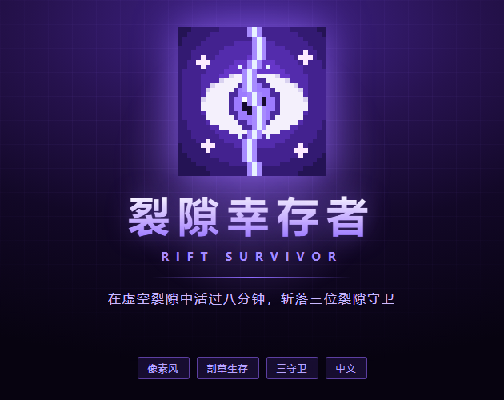

# 裂隙幸存者 · Rift Survivor

> 像素风单局生存割草游戏 · 单 HTML 文件，双击即玩

## 🎮 玩法

在持续涌来的敌潮中走位、升级、构筑流派，挑战三段 Boss 直至通关。

- **4 职业** —— 每个职业绑定专属武器与独立成长线
- **3 段 Boss 序列** —— 节奏递进的终局挑战
- **单局 8 分钟** —— 短局高密度，适合碎片时间连刷
- **局外成长** —— 用虚空币解锁永久强化，越玩越强

## ▶ 在线试玩

https://kumufengchun232.github.io/rift-survivor/

手机浏览器直接打开即可，支持横屏 / 竖屏。

## 🧩 技术栈

- HTML5 Canvas 2D
- 原生 JavaScript —— 零依赖、单文件架构
- 像素风离屏缓冲 + 最近邻放大渲染
- 移动端方向化视口与触屏控件

## 🚀 本地运行

直接双击 `index.html` 即可运行，无需安装任何环境。

## 👤 作者

kumufengchun232
